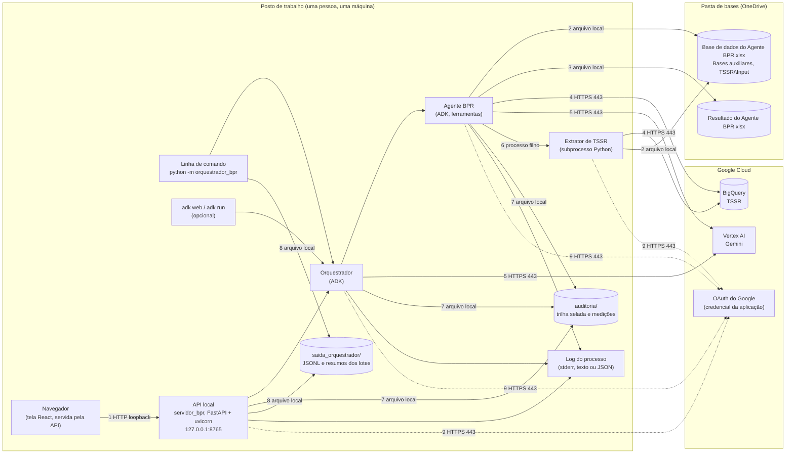

# Topologia

O desenho lógico do Agente BPR: os componentes, o que cada um faz, e cada
conexão que ele abre ou recebe, com protocolo, porta, criptografia e
autenticação. É a resposta ao item 3 do apontamento da segurança (o mesmo
pedido feito para o portal, coverage-hub/docs/TOPOLOGIA.md), e o lugar a
atualizar quando uma integração nova entrar.

Toda conexão aqui foi conferida no código (o caminho vai na tabela). O que
depende da máquina onde roda, e não do código, está marcado como **a
confirmar no ambiente**.

## Desenho lógico

## Componentes

| Componente | O que é | Onde está |
|---|---|---|
| Tela | React + Mantine, compilada em `frontend/dist` e servida pela própria API. Sem dado próprio: tudo vem da API local. | `frontend/` |
| API local | FastAPI + uvicorn, só em 127.0.0.1. Começa e acompanha lotes, exporta, conversa com o orquestrador. Aplica as guardas de servidor local, os limites, os cabeçalhos de segurança e a trilha. | `servidor_bpr/` |
| Orquestrador | Agente ADK que entende o pedido, escolhe as ações e chama o Agente BPR um endereço por vez. Filtro de injeção antes de cada chamada ao modelo. | `orquestrador_bpr/` |
| Agente BPR | Agente ADK que analisa UM endereço: lê as bases, consulta o BigQuery e grava uma linha no Excel de resultados. Guards em código limitam as ferramentas. | `agente_bpr/` |
| Extrator de TSSR | Script legado que roda como subprocesso, só com a extração autorizada (Ação 5.2B): lê os TSSRs do Input, carrega no BigQuery e move os arquivos. | `agente_bpr/extracao_tssr_agent.py` |
| Proteções | Log, trilha de auditoria selada, filtro de injeção, limites, cabeçalhos, saída para planilha, medições. | `seguranca_bpr/` |
| Trilha e medições | Arquivos JSONL por dia (trilha) e por mês (consumo da conversa), na máquina. | `BPR_AUDITORIA_DIR` (padrão `auditoria/`) |
| Saída dos lotes | `resultados.jsonl` (fonte da verdade), `resumo.csv`, `resumo.json` e `pedido.json` de cada lote. | `ORQ_SAIDA_DIR` |

## Conexões

| # | De → para | Protocolo / porta | Criptografia | Autenticação | O que trafega | Código |
|---|---|---|---|---|---|---|
| 1 | Navegador → API local | HTTP, 127.0.0.1:8765 (loopback) | Nenhuma: o tráfego não sai da máquina | Sem login (uma pessoa por máquina); a API só escuta em 127.0.0.1, só aceita Host local e exige o cabeçalho X-BPR-Local em POST | Pedidos de lote, resultados, conversa, arquivos exportados | `servidor_bpr/__main__.py`, `servidor_bpr/app.py` |
| 2 | Agente / extrator → pasta de bases | Sistema de arquivos | A do disco e a do OneDrive (**a confirmar no ambiente**) | Permissão de arquivo do usuário da máquina | Planilhas e CSVs de leitura; TSSRs movidos para Processados/Error | `agente_bpr/config.py`, `agente_bpr/ferramentas/` |
| 3 | Agente → Excel de resultados | Sistema de arquivos | Idem | Idem | Uma linha por endereço analisado (texto do modelo nunca vira fórmula) | `agente_bpr/ferramentas/persistencia.py` |
| 4 | Agente / extrator → BigQuery | HTTPS 443 (bigquery.googleapis.com) | TLS | Credencial da aplicação do Google (service account ou `gcloud auth application-default login`) | Consultas de TSSR (parâmetro ligado); carga da extração | `agente_bpr/ferramentas/comum.py`, `agente_bpr/extracao_tssr_agent.py` |
| 5 | Orquestrador / Agente → Vertex AI | HTTPS 443 (aiplatform.googleapis.com) | TLS | Credencial da aplicação; chave de API é descartada do processo | Instrução, pedido e resultado das ferramentas; resposta do modelo | `agente_bpr/credenciais.py`, `agente_bpr/modelo.py` |
| 6 | Agente → extrator | Processo filho (subprocess) | Não se aplica | Herda o usuário e as credenciais do processo, sem chave de API | Caminhos e tempo limite; desfecho lido do log do extrator | `agente_bpr/extracao_tssr_tool.py` |
| 7 | Todos → trilha e medições | Sistema de arquivos | A do disco | Permissão de arquivo; integridade pelo selo HMAC encadeado | Metadado de cada evento, nunca pergunta, resposta ou dado de negócio | `seguranca_bpr/auditoria.py`, `seguranca_bpr/consumo.py` |
| 8 | API / linha de comando → saída dos lotes | Sistema de arquivos | A do disco | Permissão de arquivo | Resultado completo de cada endereço | `orquestrador_bpr/lote.py` |
| 9 | Todos → OAuth do Google | HTTPS 443 (oauth2.googleapis.com) | TLS | A própria credencial | Troca da credencial por token de acesso | bibliotecas google-auth |

Não há outra conexão de rede: nenhum servidor de mapa, CDN ou serviço de
terceiros. A documentação da API (`/api/docs`) carrega o Swagger UI do
cdn.jsdelivr.net no navegador, e só nela.

## Os três fluxos principais

1. **Lote pela tela.** Navegador → API local (1) → orquestrador →
   Agente BPR, um endereço por vez → bases (2), BigQuery (4) e Vertex AI
   (5) → linha no Excel (3) e no JSONL do lote (8). Começo, fim e cada
   endereço vão para a trilha (7).
2. **Conversa.** Navegador → API local (1) → orquestrador, com o filtro
   de injeção antes do modelo (5). Se o pedido for de análise, segue o
   fluxo 1. A mensagem entra na trilha pelo tamanho; o consumo, nas
   medições (7).
3. **Extração autorizada (5.2B).** Só com autorização explícita, conferida
   em código pelos guards: Agente BPR → extrator (6) → TSSRs do Input (2)
   → BigQuery (4). Tentativa sem autorização é barrada e vai para a trilha.

## Pendências de ambiente

- **Pasta da trilha.** Para a trilha valer contra o próprio usuário da
  máquina, `BPR_AUDITORIA_DIR` deve apontar para uma pasta onde ele só
  acrescenta (compartilhamento com permissão de gravação sem exclusão, ou
  pasta com histórico de versões). O selo denuncia alteração em qualquer
  pasta; a permissão é o que impede.
- **Coleta do log.** A âncora da trilha vai para o log do processo. Para
  ela valer como prova fora da máquina, o log precisa ser coletado (SIEM
  ou cópia periódica), com `BPR_LOG_FORMATO=json`.
- **Chave da trilha.** `BPR_CHAVE_AUDITORIA` no cofre de senhas.
- **Criptografia em repouso** da pasta de bases e da saída: a do disco e
  do OneDrive corporativo.
